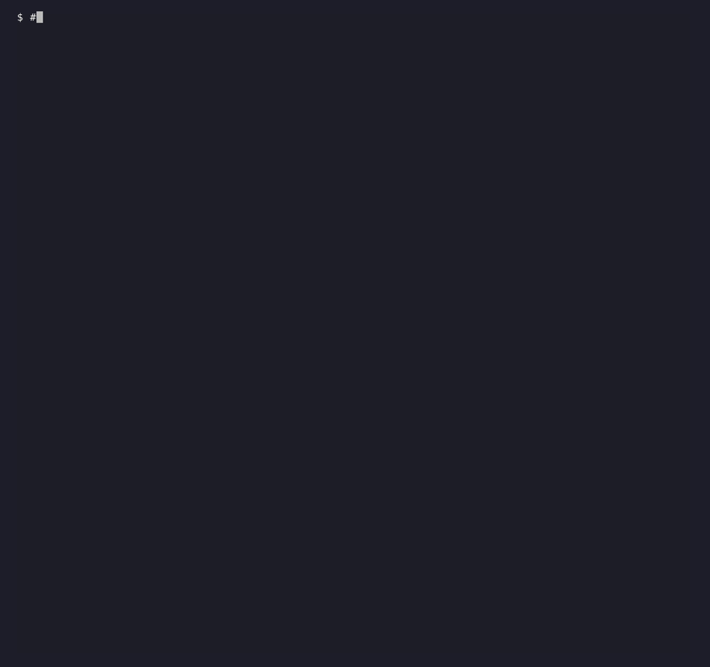
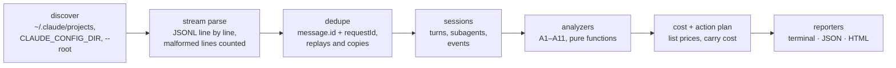
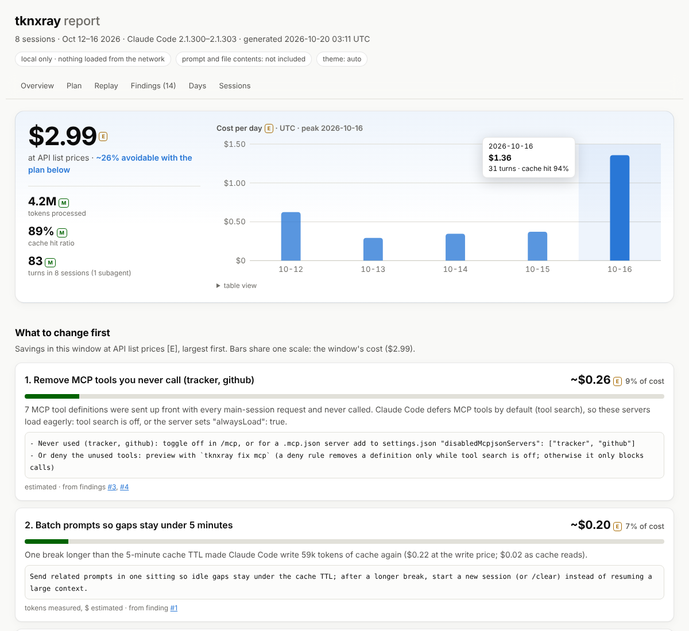
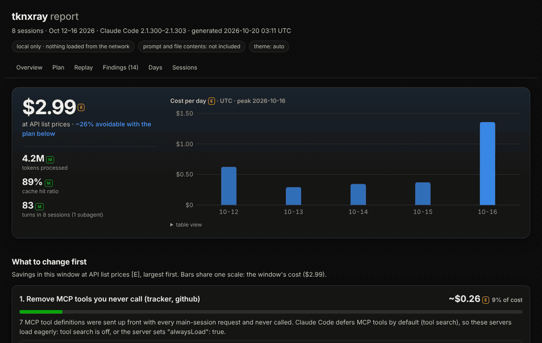

# tknxray

**Explains where your Claude Code tokens go and what you can change, using the transcripts already on your machine.**

tknxray (repo: ccxray; renamed because `ccxray` is taken on npm by an unrelated project).

[](https://github.com/alexnieves-cs/ccxray/actions/workflows/ci.yml)
[](LICENSE)



<sub>The GIF runs against a synthetic corpus made by [`scripts/demo-corpus.ts`](scripts/demo-corpus.ts). Every number in it is made up; it shows the output format, not real usage. Recorded with [vhs](https://github.com/charmbracelet/vhs) from [`docs/demo.tape`](docs/demo.tape).</sub>

Tools like [ccusage](https://github.com/ccusage/ccusage) tell you **how many** tokens you used. tknxray tries to tell you **why**: cache rebuilds and their likely cause, fixed overhead per fresh context, huge tool outputs, files read again unchanged (also across subagents), MCP tools you never call, subagent spend and wasted error turns. Each finding is priced at API list prices, and the report opens with **what to change first**: up to five concrete changes (a CLAUDE.md line, a settings snippet) ranked by what they would have saved in your own logs, with the exact setting or line to add. After you change something, `tknxray compare --at <that day>` shows whether it helped. Every finding points at the session and turn it came from, so you can check it by hand.

> **Status: 0.1.0 preview.** Everything below is implemented and tested against synthetic fixtures. On real logs it has been run on one 3.7 GB corpus (parser only: 0 malformed lines) and on its own build logs, where its token totals and list-price cost matched ccusage. A false-positive review across many users' logs is still **pending**, and token estimates marked [E] may run low (see [FORMAT.md](docs/FORMAT.md)). See the [roadmap](#roadmap).

## Privacy

- **Local only.** tknxray reads files. It makes **no network calls**: no telemetry, no update checks, no crash reports, no remote pricing. CI enforces this: [`test/no-network.test.ts`](test/no-network.test.ts) scans the built `dist/`, and runtime dependencies are allow-listed in [`deps-allowlist.json`](deps-allowlist.json) (there are none today).
- **What it reads:** Claude Code's transcripts under `~/.claude/projects` (also `~/.config/claude/projects` and `CLAUDE_CONFIG_DIR`, comma-separated). `--root DIR` points it somewhere else.
- **What reports contain:** token counts, tool names, file paths relative to the project, and the first two words of Bash commands. **Prompt and file contents are not embedded** unless you pass `--include-content`.
- The HTML report is a single self-contained file that loads nothing remote.
- The one command that opens a socket is the opt-in [`capture`](#capture-opt-in-api-key-only), which only **listens** on `127.0.0.1` and never connects anywhere.

## Install and usage

```sh
npx tknxray                 # analyze the last 7 days of ~/.claude/projects
npx tknxray --help
```

Or run from source (Node ≥ 20, pnpm):

```sh
git clone https://github.com/alexnieves-cs/ccxray.git
cd ccxray
pnpm install
pnpm build
node dist/cli.js            # analyze the last 7 days of ~/.claude/projects
node dist/cli.js --help
```

The examples below write `tknxray` for `node dist/cli.js`.

### A typical loop

```sh
tknxray                          # what cost the most, and what to change first
tknxray session latest           # check a finding turn by turn
# apply the top change, e.g. the settings snippet it printed, and work as usual for a few days
tknxray compare --at 2026-10-20  # the week before vs the week since: did it help?
tknxray watch                    # optional: keep a live view of the current session open
```

## Commands

| Command | What it does |
|---|---|
| `tknxray` | Analyze the sessions of the last 7 days: measured token totals, estimated attribution, top findings with a suggested fix each. Filters: `--since DATE`, `--until DATE` (UTC days), `--project NAME`. |
| `tknxray --json` | Machine-readable report on stdout, versioned by [`schema/report.v1.json`](schema/report.v1.json). |
| `tknxray --html report.html` | Single-file HTML report (inline CSS/JS, no external assets). |
| `tknxray session <id\|prefix\|latest>` | Per-turn view of one session: gap since the previous turn, model, input, cache write/read, output, tools called, flags for rebuilds (🔁), repeated reads (📄) and big outputs (📦), and its subagents. |
| `tknxray watch [latest\|<id\|prefix>]` | Live, full-screen view of one session (the most recently modified by default) that redraws as Claude Code writes the transcript: a context gauge for the latest turn against an assumed window, a per-turn context chart with rebuilds (↻) and compactions (◆), the latest turn's usage and tools, session totals, subagents, how long ago the last turn was vs the cache TTL, and $ at API list prices [E] for the latest turn and the session (main and subagents). Once the cache has likely expired it says what the next turn will cost to rewrite it; it never counts down while the cache is warm. Polls file size and mtime every `--interval` seconds (default 2); `--once` (or a pipe) prints one frame. Reads files only. `q` or Ctrl-C quits. |
| `tknxray compare --at DATE` | Did a change help? Compares the N days before DATE with the N days from it (`--days`, default 7), or `--before A..B --after C..D`: $ per turn and per session [E], cache hit ratio, cache writes and peak context [M], compactions and rebuilds, and how much of each kind of waste the findings priced. Rates are normalized per turn or session; the verdict says what moved, not why. |
| `tknxray doctor` | Discovered log dirs, Claude Code versions, parse stats, malformed lines and unknown record types. Run it first if numbers look off. |
| `tknxray fix mcp` | **Preview.** Prints a `permissions.deny` diff for MCP tools never called in the analyzed sessions. Dry run by default; writes only with `--apply`, after a backup. A deny rule removes a definition only while MCP tool search is off; the action plan names the other documented options (`/mcp`, `disabledMcpjsonServers`, `"alwaysLoad": false`). See [docs/fix-mcp.md](docs/fix-mcp.md). |
| `tknxray capture --i-understand-this-is-api-key-only` | **Opt-in, API key only.** See [below](#capture-opt-in-api-key-only). |
| cc-slim hook | **Prototype.** A PostToolUse hook that shortens huge Bash outputs. See [below](#cc-slim-hook-prototype). |

Other options: `--include-content`, `--threshold.KEY=VALUE` (see [docs/THRESHOLDS.md](docs/THRESHOLDS.md)), `--no-color`, `--root DIR` (repeatable).

### `capture` (opt-in, API key only)

Transcripts do not always say how big your tool definitions and system prompt are. `capture` measures one real request: it listens on `127.0.0.1`, you point Claude Code at it with `ANTHROPIC_BASE_URL` and an **API key**, and it prints sizes only (bytes and chars [M], tokens as chars/4 [E]), answers with an error and exits.

```sh
tknxray capture --i-understand-this-is-api-key-only               # prints the port
ANTHROPIC_BASE_URL=http://127.0.0.1:<port> claude -p "say hi"    # in another terminal
```

It refuses to start without that flag, forwards nothing, never stores the key, and **refuses subscription OAuth** (an `Authorization: Bearer` header or an `sk-ant-oat` key): reusing a subscription login outside Claude Code is against the terms of service. Details: [docs/capture.md](docs/capture.md).

### cc-slim hook (prototype)

[`hooks/cc-slim-posttooluse.mjs`](hooks/cc-slim-posttooluse.mjs) compresses Bash outputs over 20,000 chars: it keeps failure lines with context plus the head and tail, and collapses repeated lines and stack frames. It fails open and never blocks a tool. It needs `pnpm build` and is opt-in per project:

```json
{
  "hooks": {
    "PostToolUse": [
      {
        "matcher": "Bash",
        "hooks": [{ "type": "command", "command": "node /path/to/ccxray/hooks/cc-slim-posttooluse.mjs" }]
      }
    ]
  }
}
```

**UNVERIFIED:** whether Claude Code lets a PostToolUse hook replace the output of the built-in Bash tool (the field it uses is documented for MCP tools). Until that is checked, the hook may have no effect. No savings are claimed. Design and measurement plan: [docs/cc-slim.md](docs/cc-slim.md).

## How it works



- **Discover** finds `projects/{project}/{sessionId}.jsonl` and nested subagent transcripts.
- **Stream parse** reads one line at a time (no full-file loads) with hand-written type guards. Unknown fields are ignored, missing fields tolerated, malformed lines counted and skipped. The transcript format is undocumented; what is known and what is assumed is in [docs/FORMAT.md](docs/FORMAT.md).
- **Dedupe** counts the `usage` of one API response once, even though Claude Code writes one line per content block and can copy a response into several files.
- **Sessions** orders turns by timestamp and links subagents to the tool call that started them.
- **Analyzers** are pure, deterministic functions with configurable thresholds.
- **Cost and action plan** price every turn from a bundled, dated list-price table (no network), give each finding a cost and a plausible saving, and pick the five changes worth the most ([SPEC §5.1–5.3](docs/SPEC.md#51-cost-model-m7)).
- **Reporters** render the same report as a terminal summary, JSON or HTML.

## Analyzers

From [SPEC §5](docs/SPEC.md#5-analyzers) and [`src/analyzers/`](src/analyzers).

| ID | Analyzer | What it finds | Tokens |
|---|---|---|---|
| A1 | totals | Deduped input, cache write (5m/1h), cache read and output per session, project, model and day; cache hit ratio = read / (read + write + input). Built into every report as the totals, not a finding. | measured |
| A2 | cache-rebuild | Turns where the cache was rebuilt: a large cache write while cache read dropped by half or more vs the previous turn. | measured (cache write of the turn) |
| A3 | rebuild-cause | The likely cause of each rebuild: idle gap past the cache TTL, Claude Code upgrade, model switch, compaction, CLAUDE.md change, tool set change, or unknown. Shown inside A2 findings. | cause counts measured; per-cause token split and tool-set inference estimated |
| A4 | fixed-overhead | Baseline context of the first turn of each session, its median per Claude Code version, and jumps between versions. | measured; size of logged tool definitions estimated |
| A5 | big-tool-output | Tool results of about 5k tokens or more, grouped by tool and short command (e.g. `pnpm test`). | estimated (chars/4) |
| A6 | repeated-read | The same file read again with no edit or write in between. | estimated (size of the later reads) |
| A7 | tool-usage | Calls per tool, and tools or whole MCP servers never called. | call counts measured; cost of unused definitions estimated, and only when the transcript logs them |
| A8 | context-growth | Sessions whose context grew past 150k tokens, or that compacted repeatedly. | measured |
| A9 | subagent-cost | Usage of subagent transcripts vs their parent session, and the models they ran on. | measured |
| A10 | error-waste | API error turns and retries, and failed tool calls repeated with the same input. | errors measured; repeated calls estimated |
| A11 | cross-agent-read | The same file read by 3 or more agents (main session and subagents) of one session, each carrying its own copy. Counts Read and plain `cat FILE`; the same relative path read from several git worktrees is one file. | estimated (chars/4) |
| A12 | cache-ttl | Whether the other prompt-cache TTL would have cost less for the main conversations: 1h when 5–60 minute breaks keep forcing rebuilds, 5m when 1h was rarely needed. The fix is `"promptCacheTtl"` in settings.json. | measured tokens; $ estimated |

## Measured vs estimated

Every number tknxray prints carries one of two labels:

- **[M] measured:** summed directly from the `usage` fields Claude Code logs for each API response (input, cache write, cache read, output), or a plain count of records. Exact for what the logs contain.
- **[E] estimated** (also shown with a leading `~`): a heuristic. Token sizes of tool outputs, reads and tool definitions use `ceil(chars / 4)`, not a tokenizer. Splitting a measured total between causes or tools is an attribution guess. Treat these as orders of magnitude.

Estimates are never presented as exact. Findings from different analyzers can overlap (the same tokens can be part of a rebuild and of a big output), so their token figures do not add up and are **not savings**. Every finding lists evidence (session, turn, file and line) so you can verify it.

## Cost and what to change first

Token counts mix kinds that differ about 100× in price (a cache read vs output), so tknxray also prices every turn at **API list prices** from a table bundled with the release (`src/cost/prices.ts`, dated; never fetched). Every $ is labeled **[E]**:

> $ = what these tokens would cost at API list prices; subscription limits are not published, use it to compare, not as a bill

- **COST** splits the window's $ by token kind and by main session vs subagents. Unknown models are left out and named, never guessed.
- **Each finding** gets `impact { costUsd, savingsUsd, basis }`, and TOP FINDINGS are ranked by savings. Content from a tool result is priced over every turn it stayed in context (written once, then re-read until a compaction).
- **BY PROJECT** and **BY DAY** show where the $ went [E] when there is more than one project or day: the top five projects with turns and cache hit ratio, and the last 14 UTC days. The HTML report has the project table too.
- **WHAT TO CHANGE FIRST** lists up to five changes with their saving, share of cost, a copy-pasteable change and the findings behind it. The combined line ("These N changes would have cut about X% of this window's cost [E]") is a conservative union, not a sum, because levers overlap. A cheaper subagent model may need more or fewer tokens and may do worse; savings from context size are upper bounds.

These are estimates for *your* logs and window, not a product claim. How each number is computed, and what is still unverified, is in [SPEC §5.1–5.3](docs/SPEC.md#51-cost-model-m7).

## HTML report

`tknxray --html report.html` writes one self-contained file you can attach to a bug report:



It opens with the window's cost and a per-day chart you can hover or tab through, then the action plan, a session replay that plays the context filling up and stops at cache rebuilds, and every finding with its evidence:



<sub>Rendered from the same synthetic corpus as the terminal GIF. The numbers are made up. The report GIF is recorded with Playwright from [`scripts/record-report-gif.cjs`](scripts/record-report-gif.cjs).</sub>

## Performance

Benchmarks live in [`bench/`](bench) and run on synthetic corpora generated by [`bench/corpus.ts`](bench/corpus.ts). Results come from `pnpm bench` (10 MB and 100 MB) or `pnpm bench:full` (adds 1 GB). This README quotes no numbers.

## Roadmap

| Milestone | Scope | Status |
|---|---|---|
| M0 Scaffold | pnpm, tsup, vitest, eslint/prettier, CI on Node 20/22 × Linux/macOS/Windows, no-network test | Implemented |
| M1 Parser | discover, streaming reader, dedupe, sessions, subagent linking, `doctor`, fixture DSL | Implemented; real-log validation **pending** |
| M2 Core analyzers | A1, A2, A3, A5, A6, estimator calibration | Implemented; real-log validation and the ccusage cross-check (`pnpm validate:real`) **pending** |
| M3 Reporters | terminal, JSON (schema v1), self-contained HTML | Implemented |
| M4 More analyzers | A4, A7, A8, A9, A10, `session` view, thresholds | Implemented; real-log true/false-positive review **pending** |
| M5 Fix modules (preview) | `fix mcp`, cc-slim prototype hook, opt-in `capture` | Implemented as previews; the hook's effect on Bash is **UNVERIFIED** |
| M6 Live and replay | `watch` live view, session replay in the HTML report, dogfood fixes | Implemented |
| M7 Impact | list-price cost, $ impact per finding, A11 cross-agent reads, action plan in every reporter | Implemented; total cost matches ccusage on the dogfood snapshot; savings are estimates |
| M8 Close the loop | `compare`, A12 cache-ttl, documented settings in every change (MCP tool search, output caps, cache TTL), cost by project and day, `cat` and worktree reads in A11, $ in `watch` | Implemented |

Not done yet: a false-positive review of every analyzer on other people's logs, publishing to npm, and any savings benchmark. This README will make no savings claim until a reproducible benchmark ([SPEC §8](docs/SPEC.md#8-benchmarks-and-performance-targets)) supports one.

## Contributing

Read [CLAUDE.md](CLAUDE.md) (the rules for humans and agents) and [docs/SPEC.md](docs/SPEC.md) (the source of truth) first. In short: no network calls, label every number [M] or [E], never invent transcript schema (mark assumptions `// UNVERIFIED:`), never commit real transcripts (fixtures are synthetic: see `scripts/make-fixture.ts` and `scripts/scrub-fixture.ts`), and `pnpm lint && pnpm typecheck && pnpm test` must pass.

## Disclaimer

tknxray is an independent project. It is **not affiliated with, endorsed by or sponsored by Anthropic**. "Claude" and "Claude Code" are trademarks of Anthropic. tknxray only reads logs on your machine and does not change Claude Code's requests.

## License

[MIT](LICENSE) © 2026 Alex Nieves
