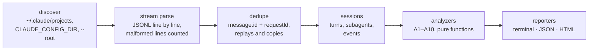

# ccxray

**Explains where your Claude Code tokens go and what you can change, using the transcripts already on your machine.**

[](https://github.com/alexnieves-cs/ccxray/actions/workflows/ci.yml)
[](LICENSE)


<sub>The GIF runs against a synthetic corpus made by [`scripts/demo-corpus.ts`](scripts/demo-corpus.ts). Every number in it is made up; it shows the output format, not real usage. Recorded with [vhs](https://github.com/charmbracelet/vhs) from [`docs/demo.tape`](docs/demo.tape).</sub>

Tools like [ccusage](https://github.com/ccusage/ccusage) tell you **how many** tokens you used. ccxray tries to tell you **why**: cache rebuilds and their likely cause, fixed overhead per fresh context, huge tool outputs, files read again unchanged, MCP tools you never call, subagent spend and wasted error turns. Every finding points at the session and turn it came from, so you can check it by hand.

> **Status: preview.** Milestones M0–M5 are implemented and tested against synthetic fixtures. Validation against real logs is **pending**. See the [roadmap](#roadmap).

## Privacy

- **Local only.** ccxray reads files. It makes **no network calls**: no telemetry, no update checks, no crash reports, no remote pricing. CI enforces this: [`test/no-network.test.ts`](test/no-network.test.ts) scans the built `dist/`, and runtime dependencies are allow-listed in [`deps-allowlist.json`](deps-allowlist.json) (there are none today).
- **What it reads:** Claude Code's transcripts under `~/.claude/projects` (also `~/.config/claude/projects` and `CLAUDE_CONFIG_DIR`, comma-separated). `--root DIR` points it somewhere else.
- **What reports contain:** token counts, tool names, file paths relative to the project, and the first two words of Bash commands. **Prompt and file contents are not embedded** unless you pass `--include-content`.
- The HTML report is a single self-contained file that loads nothing remote.
- The one command that opens a socket is the opt-in [`capture`](#capture-opt-in-api-key-only), which only **listens** on `127.0.0.1` and never connects anywhere.

## Install and usage

> **Not published yet.** The npm package name is not decided (`ccxray` is taken on npm by an unrelated project; see [SPEC §10](docs/SPEC.md#10-distribution)). Once it is published it will run as:
>
> ```sh
> npx <name>
> ```

Run from source (Node ≥ 20, pnpm):

```sh
git clone https://github.com/alexnieves-cs/ccxray.git
cd ccxray
pnpm install
pnpm build
node dist/cli.js            # analyze the last 7 days of ~/.claude/projects
node dist/cli.js --help
```

The examples below write `ccxray` for `node dist/cli.js`.

## Commands

| Command | What it does |
|---|---|
| `ccxray` | Analyze the sessions of the last 7 days: measured token totals, estimated attribution, top findings with a suggested fix each. Filters: `--since DATE`, `--until DATE` (UTC days), `--project NAME`. |
| `ccxray --json` | Machine-readable report on stdout, versioned by [`schema/report.v1.json`](schema/report.v1.json). |
| `ccxray --html report.html` | Single-file HTML report (inline CSS/JS, no external assets). |
| `ccxray session <id\|prefix\|latest>` | Per-turn view of one session: gap since the previous turn, model, input, cache write/read, output, tools called, flags for rebuilds (🔁), repeated reads (📄) and big outputs (📦), and its subagents. |
| `ccxray doctor` | Discovered log dirs, Claude Code versions, parse stats, malformed lines and unknown record types. Run it first if numbers look off. |
| `ccxray fix mcp` | **Preview.** Prints a `permissions.deny` diff for MCP tools never called in the analyzed sessions. Dry run by default; writes only with `--apply`, after a backup. See [docs/fix-mcp.md](docs/fix-mcp.md). |
| `ccxray capture --i-understand-this-is-api-key-only` | **Opt-in, API key only.** See [below](#capture-opt-in-api-key-only). |
| cc-slim hook | **Prototype.** A PostToolUse hook that shortens huge Bash outputs. See [below](#cc-slim-hook-prototype). |

Other options: `--include-content`, `--threshold.KEY=VALUE` (see [docs/THRESHOLDS.md](docs/THRESHOLDS.md)), `--no-color`, `--root DIR` (repeatable).

### `capture` (opt-in, API key only)

Transcripts do not always say how big your tool definitions and system prompt are. `capture` measures one real request: it listens on `127.0.0.1`, you point Claude Code at it with `ANTHROPIC_BASE_URL` and an **API key**, and it prints sizes only (bytes and chars [M], tokens as chars/4 [E]), answers with an error and exits.

```sh
ccxray capture --i-understand-this-is-api-key-only               # prints the port
ANTHROPIC_BASE_URL=http://127.0.0.1:<port> claude -p "say hi"    # in another terminal
```

It refuses to start without that flag, forwards nothing, never stores the key, and **refuses subscription OAuth** (an `Authorization: Bearer` header or an `sk-ant-oat` key): reusing a subscription login outside Claude Code is against the terms of service. Details: [docs/capture.md](docs/capture.md).

### cc-slim hook (prototype)

[`hooks/cc-slim-posttooluse.mjs`](hooks/cc-slim-posttooluse.mjs) compresses Bash outputs over 20,000 chars: it keeps failure lines with context plus the head and tail, and collapses repeated lines and stack frames. It fails open and never blocks a tool. It needs `pnpm build` and is opt-in per project:

```json
{
  "hooks": {
    "PostToolUse": [
      {
        "matcher": "Bash",
        "hooks": [{ "type": "command", "command": "node /path/to/ccxray/hooks/cc-slim-posttooluse.mjs" }]
      }
    ]
  }
}
```

**UNVERIFIED:** whether Claude Code lets a PostToolUse hook replace the output of the built-in Bash tool (the field it uses is documented for MCP tools). Until that is checked, the hook may have no effect. No savings are claimed. Design and measurement plan: [docs/cc-slim.md](docs/cc-slim.md).

## How it works



- **Discover** finds `projects/{project}/{sessionId}.jsonl` and nested subagent transcripts.
- **Stream parse** reads one line at a time (no full-file loads) with hand-written type guards. Unknown fields are ignored, missing fields tolerated, malformed lines counted and skipped. The transcript format is undocumented; what is known and what is assumed is in [docs/FORMAT.md](docs/FORMAT.md).
- **Dedupe** counts the `usage` of one API response once, even though Claude Code writes one line per content block and can copy a response into several files.
- **Sessions** orders turns by timestamp and links subagents to the tool call that started them.
- **Analyzers** are pure, deterministic functions with configurable thresholds.
- **Reporters** render the same report as a terminal summary, JSON or HTML.

## Analyzers

From [SPEC §5](docs/SPEC.md#5-analyzers) and [`src/analyzers/`](src/analyzers).

| ID | Analyzer | What it finds | Tokens |
|---|---|---|---|
| A1 | totals | Deduped input, cache write (5m/1h), cache read and output per session, project, model and day; cache hit ratio = read / (read + write + input). | measured |
| A2 | cache-rebuild | Turns where the cache was rebuilt: a large cache write while cache read dropped by half or more vs the previous turn. | measured (cache write of the turn) |
| A3 | rebuild-cause | The likely cause of each rebuild: idle gap past the cache TTL, Claude Code upgrade, model switch, compaction, CLAUDE.md change, tool set change, or unknown. Shown inside A2 findings. | cause counts measured; per-cause token split and tool-set inference estimated |
| A4 | fixed-overhead | Baseline context of the first turn of each session, its median per Claude Code version, and jumps between versions. | measured; size of logged tool definitions estimated |
| A5 | big-tool-output | Tool results of about 5k tokens or more, grouped by tool and short command (e.g. `pnpm test`). | estimated (chars/4) |
| A6 | repeated-read | The same file read again with no edit or write in between. | estimated (size of the later reads) |
| A7 | tool-usage | Calls per tool, and tools or whole MCP servers never called. | call counts measured; cost of unused definitions estimated, and only when the transcript logs them |
| A8 | context-growth | Sessions whose context grew past 150k tokens, or that compacted repeatedly. | measured |
| A9 | subagent-cost | Usage of subagent transcripts vs their parent session, and the models they ran on. | measured |
| A10 | error-waste | API error turns and retries, and failed tool calls repeated with the same input. | errors measured; repeated calls estimated |

## Measured vs estimated

Every number ccxray prints carries one of two labels:

- **[M] measured:** summed directly from the `usage` fields Claude Code logs for each API response (input, cache write, cache read, output), or a plain count of records. Exact for what the logs contain.
- **[E] estimated** (also shown with a leading `~`): a heuristic. Token sizes of tool outputs, reads and tool definitions use `ceil(chars / 4)`, not a tokenizer. Splitting a measured total between causes or tools is an attribution guess. Treat these as orders of magnitude.

Estimates are never presented as exact. Findings from different analyzers can overlap (the same tokens can be part of a rebuild and of a big output), so their token figures do not add up and are **not savings**. Every finding lists evidence (session, turn, file and line) so you can verify it.

## HTML report

`ccxray --html report.html` writes one self-contained file you can attach to a bug report:


<sub>Rendered from the same synthetic corpus as the GIF. The numbers are made up.</sub>

## Performance

Benchmarks live in [`bench/`](bench) and run on synthetic corpora generated by [`bench/corpus.ts`](bench/corpus.ts). Results come from `pnpm bench` (10 MB and 100 MB) or `pnpm bench:full` (adds 1 GB). This README quotes no numbers.

## Roadmap

| Milestone | Scope | Status |
|---|---|---|
| M0 Scaffold | pnpm, tsup, vitest, eslint/prettier, CI on Node 20/22 × Linux/macOS/Windows, no-network test | Implemented |
| M1 Parser | discover, streaming reader, dedupe, sessions, subagent linking, `doctor`, fixture DSL | Implemented; real-log validation **pending** |
| M2 Core analyzers | A1, A2, A3, A5, A6, estimator calibration | Implemented; real-log validation and the ccusage cross-check (`pnpm validate:real`) **pending** |
| M3 Reporters | terminal, JSON (schema v1), self-contained HTML | Implemented |
| M4 More analyzers | A4, A7, A8, A9, A10, `session` view, thresholds | Implemented; real-log true/false-positive review **pending** |
| M5 Fix modules (preview) | `fix mcp`, cc-slim prototype hook, opt-in `capture` | Implemented as previews; the hook's effect on Bash is **UNVERIFIED** |

Not done yet: real-log validation of every analyzer, choosing an npm name and publishing, and any savings benchmark. This README will make no savings claim until a reproducible benchmark ([SPEC §8](docs/SPEC.md#8-benchmarks-and-performance-targets)) supports one.

## Contributing

Read [CLAUDE.md](CLAUDE.md) (the rules for humans and agents) and [docs/SPEC.md](docs/SPEC.md) (the source of truth) first. In short: no network calls, label every number [M] or [E], never invent transcript schema (mark assumptions `// UNVERIFIED:`), never commit real transcripts (fixtures are synthetic: see `scripts/make-fixture.ts` and `scripts/scrub-fixture.ts`), and `pnpm lint && pnpm typecheck && pnpm test` must pass.

## Disclaimer

ccxray is an independent project. It is **not affiliated with, endorsed by or sponsored by Anthropic**. "Claude" and "Claude Code" are trademarks of Anthropic. ccxray only reads logs on your machine and does not change Claude Code's requests.

## License

[MIT](LICENSE) © 2026 Alex Nieves
